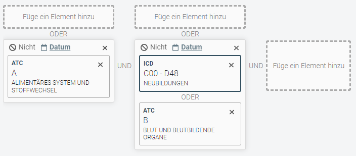

# cqapi

cqapi (ConqueryApi) is a Python Api for the [conquery backend](https://github.com/ingef/conquery).  
Next to interacting with Conquery via the ConqueryConnection-Class it has functionality to 
read, edit and write the conquery queries which are specified in json. 

## Installation
- Some functionality of `cqapi` requires Python version `>= 3.8` and `<=3.9`
- Installation is done with poetry. Poetry is a dependency manager for python. It is used to install all dependencies and to create a virtual environment. To install poetry, follow the instructions on the [poetry website](https://python-poetry.org/docs/#installation). 
  After installing poetry, run the following commands in the root directory of the project:

```bash
poetry install
```

## Running Tests

`python -m pytest tests/`

## Usage
**Note: There are multiple Notebooks for guidance in the examples-folder in the Forms-Repo**

### Basic functionality
Establish a connection to a conquery instance
```python
from cqapi import ConqueryConnection

cq = ConqueryConnection("http://conquery-base.url:9082")
```
When a user builds and executes a query in the Conquery Editor, that query is then stored in the conquery backend with a unique query_id.
When the user drops that query_id in a Jupyend-Form, we receive that query_id as a string.

We can access meta information about that query:
```python
cq.get_query_info(query_id)
```

We can also get the data of all the people in the query group with the selected covariates:
```python
data = cq.get_query_result(query_id)
```

### Concepts
Concepts are listed on the left hand side in Conquery.
Each Concept is described by an ID.

The class ConqueryId and the classes for each ID-type that inherit from it
are defined in ```cqapi.conquery_ids```
It is clear from the structure of the classes, how the IDs can be built and what combinations
are possible. 

To provide an overview, these are the possible ID combinations including examples.
```
Dataset - Concept
-> fdb_demo.alter

Dataset - Concept - Connector
-> fdb_demo.icd.kh_diagnose_icd_code
 
Dataset - Child - Child - (...)
-> fdb_demo.icd.c00-d48.c00-c14.c01

Dataset - Concept - Select
-> fdb_demo.ops.exists
 
Dataset - Concept - Connector - Select
-> fdb_demo.icd.au_fall.anzahl_au_faelle

Dataset - Concept - Connector - Date
-> fdb_demo.atc.atc.verordnungsdatum

Dataset - Concept - Connector - Filter
-> fdb_demo.icd.arzt_diagnose_icd_code.diagnosesicherheit

Dataset - SecondaryId
-> fdb_demo.drg

Dataset - Table - Column  # only am_300
-> fdb_demo.am300_belegpositionen.beleg_brutto_summe
```
Each ConqueryId only describes one part of the ID, such as the ConnectorId, and defines a base
that it is built on, such as a ConceptId. This goes down to the DatasetId, which cannot have a base.

To initiate a ConqueryId such as ```fdb_demo.ops.exists``` either use the from_str method
or initiate all the bases of the ID.

Example:
```python
from cqapi.conquery_ids import DatasetId, ConceptId, SelectId

ops_exists_select = SelectId.from_str("fdb_demo.ops.exists")

# or

dataset = DatasetId("fdb_demo")
ops_concept = ConceptId("ops", dataset)
ops_exists_select = SelectId("exists", ops_concept)
```

### Editor Queries
In the Editor we can put together queries and evaluate them to get the group of insurants that fulfil the
specifications including covariates that are specified by the selects.
We can specify the same queries (with some more liberties than we have in the graphical editor) with the cqapi.

An editor query can consist of multiple building blocks.
One possible building block are ConceptElement's. A ConceptElement must contain at least an Id and a ConceptTable, 
that describes which table the Id is based on.
Other building blocks are ExternalQuery's (user-uploaded queries in the backend) and SavedQuery's (previously executed and 
stored queries in the backend).

```
Building blocks:
- ConceptElement
    - ConceptTable
- ExternalQuery
- SavedQuery
```

Each building block can be (but does not have to be) wrapped into a DateRestriction, a Negation or 
an OrElement / AndElement.

```
Building block wrappers (optional):
- Date Restriction
- Negation
- AndElement
- OrElement
```

Finally, the building blocks must be wrapped in a ConceptQuery (regular query with one row for each insurant) 
or a SecondaryIdQuery (allocating a secondary id to the query, so that there is a row for each insurant and each value
of the secondary id).

```
Editor query wrappers:
- ConceptQuery
- SecondaryIdQuery
```

These editor queries can be executed and we get the query_id returned.
```python
from cqapi.api import ConqueryConnection
ConqueryConnection.execute_query()
```

For example, take this editor query:



**Note: This is a very base level approach, which is explained only to illustrate the functionality.
There are more user-friendly ways of creating queries, which are described in "Creating Queries",
however those functions use the same functionality under the hood.**

First we have to initiate the building blocks and then use the ```OrElement, AndElement``` to make a logical statement
which we can then wrap in a ConceptQuery.

```python
from cqapi.queries.base_elements import ConceptElement, OrElement, AndElement, ConceptQuery, ConceptTable
from cqapi.conquery_ids import ChildId, ConnectorId

# ConceptElement ATC A
atc_a = ChildId.from_str("fdb_demo.atc.a")
atc_connector = ConnectorId.from_str("fdb_demo.atc.atc")
atc_a_concept_element = ConceptElement(ids=[atc_a], 
                                       tables=[ConceptTable(connector_id=atc_connector)])

# Concept Element ICD C00-D48
icd_c00_d48 = ChildId.from_str("fdb_demo.icd.c00-d48")
icd_kh_connector = ConnectorId.from_str("fdb_demo.icd.kh_diagnose_icd_code")
icd_c00_d48_concept_element = ConceptElement(ids=[icd_c00_d48], 
                                       tables=[ConceptTable(connector_id=icd_kh_connector)])

# Concept Element ATC B
atc_b = ChildId.from_str("fdb_demo.atc.b")
atc_b_concept_element = ConceptElement(ids=[atc_b], 
                                       tables=[ConceptTable(connector_id=atc_connector)])

# Or Element, AndElement
or_query = OrElement(children=[icd_c00_d48_concept_element, atc_b_concept_element])

and_query = AndElement(children=[atc_a_concept_element, or_query])

# ConceptQuery
concept_query = ConceptQuery(root=and_query)

# Execute query
query_id = cq.execute_query(query=concept_query)

```

**Note: All of the classes we used here (ConceptElement, AndElement, ConceptQuery, etc.) all inherit from QueryObject. 
QueryObject is the base class for all types of queries**

### Form Queries
#### Absolute Export Form
We can choose specific covariates to include in the data using the editor, such as costs, diagnosis, residence, etc. 
However, we only receive those covariates for the group of insurants that satisfy the logical statement specified in 
the editor. For instance, if we want to identify all individuals living in Bavaria and determine if they had Diabetes, 
we would select the concepts "Bavaria" and "Diabetes" with the condition "exists." By including 
Diabetes in our logical statement, we narrow down the insurant group to only those who had Diabetes. 
This is where form queries come in.

With a forms query, we can specify the group we want to look at (query_id), and also specify the features we want to
get for each insurant in the group.
The most basic form query is the AbsoluteExportForm, which looks at a fixed time period.

**Note: Again, queries can be created more easily, they are just used here to demonstrate the ExportForms**
```python
from cqapi.queries.form_elements import AbsoluteExportForm
from cqapi.queries.base_elements import ConceptElement, ConceptTable, ConceptQuery
from cqapi.conquery_ids import ChildId, ConnectorId, SelectId

# create query with all people in bavaria
bavaria_concept = ChildId.from_str("fdb_demo.bundesland_und_kgs.09")
bavaria_connector = ConnectorId.from_str("fdb_demo.bundesland_und_kgs.bundesland_regionale_daten")
bavaria_concept_element = ConceptElement(ids=[bavaria_concept], 
                                         tables=[ConceptTable(connector_id=bavaria_connector)])
bavaria_query_id = cq.execute_query(query=ConceptQuery(root=bavaria_concept_element))

# create concept element of diabetes
icd_diabetes = ChildId.from_str("fdb_demo.icd.e00-e90.e10-e14")
icd_select_exists = SelectId.from_str("fdb_demo.icd.exists")
icd_connector = ConnectorId.from_str("fdb_demo.icd.arzt_diagnose_icd_code")
icd_diabetes_concept_element = ConceptElement(ids=[icd_diabetes], 
                                              concept_selects=[icd_select_exists],
                                              tables=[ConceptTable(connector_id=icd_connector)])

# get form query of all people in bavaria and whether they have diabetes
form_query = AbsoluteExportForm(query_id=bavaria_query_id, features=[icd_diabetes_concept_element])

form_query_id = cq.execute_query(query=form_query)


# other optional parameters
resolutions: List[str]  # ["COMPLETE", "YEARS", "QUARTERS", "DAYS"]
create_resolution_subdivisions: bool  # if chosen exactly one resolution, this also creates the coarser subdivisions
date_range: Union[List[str], dict]
start_date: str
end_date: str
```

#### Relative Export Form
With the relative export form, we don't specify an absolute time period, but the time period is relative to an index 
date that is chosen from a list of dates. The list of dates for each insurant are provided in the data.
The date can be retrieved from the list of dates by the earliest, latest or random.
```python
index_selector: str = 'EARLIEST'
# other options: LATEST, RANDOM
```

Then it can be specified which time unit is used, and how many units before and after the index date we want to get 
the data from. Also, it needs to be specified whether the index date should be counted to the time before, the time 
after or whether it should be neutral and therefore in neither of those date ranges.

```python
time_unit: str = "QUARTERS"
# other options: DAYS

time_count_before: int = 1
time_count_after: int = 1
# must be positive

index_placement: str = 'BEFORE'
# other options: AFTER, NEUTRAL
```

Now we want to take the query group of Bavarians we used in the previous example, and now I want to get 
the four quarters before and four quarters after their Diabetes diagnosis. We want to include the index date 
in the after-index-date-period, because they probably already received treatment in the quarter of diagnosis.

```python
from cqapi.queries.form_elements import RelativeExportForm

form_query = RelativeExportForm(query_id=bavaria_query_id, features=[icd_diabetes_concept_element],
                                time_count_before=4, time_count_after=4, index_placement="AFTER")
# I don't have to specify that I want quarters as my time period and that the index selector is the earliest, 
# since those are the default values.

form_query_id = cq.execute_query(query=form_query)

```

#### Entity Date Export Form
The Entity Date Export Form is a type of Absolute Export Form. 
The only difference is, that the EntityDateForm only returns data points that are within the date periods in the data.

#### Full Export Form
The Full Export Form returns the data in the form of the tables, that provide the data.
It is a raw export and rarely used.

### Creating Queries
With the function create_query we can create queries much more easily than initiating
all the objects ourselves. Mostly, it is not necessary to specify a table. However, if only a specific connector (like kh or arzt) should be used, it can be speficied using connector_ids.

Here is the full parameter list, which explains the functionality by itself:
```python
from cqapi.queries.base_elements import create_query

def create_query(concept_id: Union[str, ConceptId, ChildId, List[str], List[ConceptId], List[ChildId], list],
                 concepts: dict,
                 concept_query: bool = False,
                 secondary_id: Optional[Union[str, SecondaryId]] = None,
                 connector_ids: Union[List[ConnectorId], List[str]] = None,
                 concept_select_ids: Union[List[SelectId], List[str]] = None,
                 connector_select_ids: Union[List[SelectId], List[str]] = None,
                 filter_objs: List[dict] = None,
                 exclude_from_secondary_id: bool = None,
                 exclude_from_time_aggregation: bool = None,
                 date_aggregation_mode: str = None,
                 start_date: str = None, end_date: str = None,
                 label: str = None,
                 negate: bool = False) -> QueryObject
```
Let's say, we want to create the Diabetes query again. Since we don't need to provide a table here, we can simply define 
the query as follows:
```python
icd_diabetes = ChildId.from_str("fdb_demo.icd.e00-e90.e10-e14")
icd_select_exists = SelectId.from_str("fdb_demo.icd.exists")

create_query(concept_id=icd_diabetes, concept_select_ids=[icd_select_exists], concepts=concepts)
```
#### Query Editor
Once we have created our query, we can use the QueryEditor to manipulate the query, without much overhead.
Here is just part of the functionality available:
```
- date_restriction
  
- concept_query
  
- negate
  
- and_query

- add_concept_select

- add_connector_select

- remove_all_selects

- translate

- remove_all_tables_but

- ...
```

Now we take the first concept query we made and recreate it using ```create_query``` and ```QueryEditor```:

```python

from cqapi.queries.editor import QueryEditor
from cqapi.queries.base_elements import create_query
from cqapi.conquery_ids import ChildId

# ConceptElement ATC A
atc_a = ChildId.from_str("fdb_demo.atc.a")

atc_a_query = create_query(concept_id=atc_a, concepts=concepts)

# Concept Element ICD C00-D48
icd_c00_d48 = ChildId.from_str("fdb_demo.icd.c00-d48")

atc_c00_d48_query = create_query(concept_id=icd_c00_d48, concepts=concepts)

# Concept Element ATC B
atc_b = ChildId.from_str("fdb_demo.atc.b")

atc_b_query = create_query(concept_id=atc_b, concepts=concepts)

# Or Element, And Element
query_editor = QueryEditor(atc_c00_d48_query)

query_editor.or_query(atc_b_query)

query_editor.and_query(atc_a_query)

# ConceptQuery
query_editor.concept_query()

# Execute query
query = query_editor.query

query_id = cq.execute_query(query=query)

```

### FAQ
- _What is the difference between a query and a query id?_
  
  When we build a query we do that by creating a QueryObject. This is only an instance of a class. When we have executed 
that query using the conquery backend, we get back a query_id, which is a string.


- _Which queries are executable?_
  
  Only ConceptQuery, SecondaryIdQuery and all types of ExportForms are executable.


- _Why is the query group in an Export Form described by a query_id but the features are QueryObjects?_

  The query group is the population for which we want to get the data (therefore we need to execute the query). 
The features are just information that we want about that group. QueryObjects can either describe groups of
insurants or they can describe features about a group.
